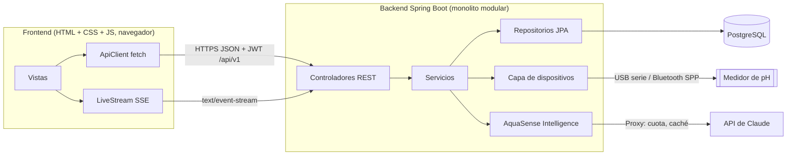
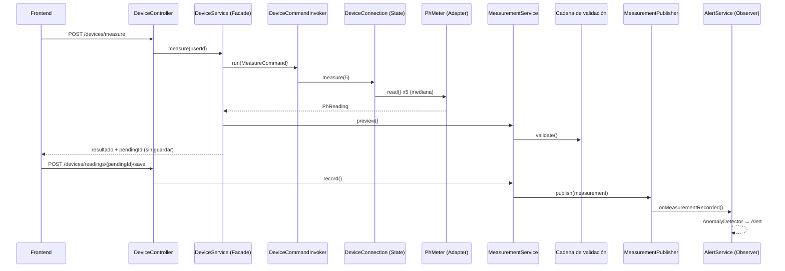
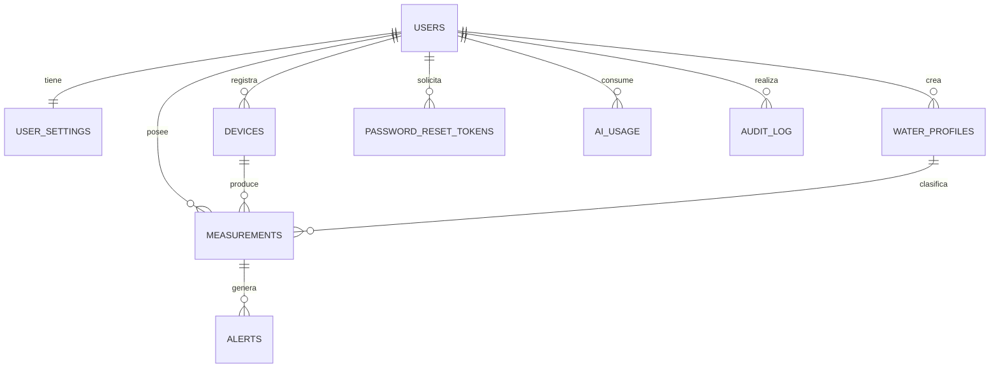

# Arquitectura · AquaSense AI

## Vista general

- **Frontend**: solo presentación y animaciones. No calcula clasificaciones ni límites de plan. No conoce la base de datos ni las claves.
- **Backend**: toda la lógica, la persistencia, el hardware y la IA.
- **Comunicación**: REST versionado (`/api/v1`) con DTO; eventos en vivo por Server-Sent Events.

## Flujo de una medición con el medidor

El origen (`REAL` o `SIMULATED`) lo decide el servidor según el adaptador conectado; el cliente no puede declarar una lectura como real.

## Modelo de datos

| Tabla | Contenido clave |
|---|---|
| `users` | correo único, hash Argon2id, rol (`USER`/`ADMIN`), plan (`FREE`/`PREMIUM`), versión de token |
| `user_settings` | perfil activo, tema, notificaciones, guardado automático, idioma |
| `water_profiles` | rangos ideal y de precaución con `CHECK` de orden y límites 0-14; fuente; `system_profile` |
| `measurements` | pH (`CHECK 0-14`), temperatura, fecha, origen (`CHECK REAL/SIMULATED/MANUAL`), naturaleza, estado, validación, nota; índice `(user_id, measured_at DESC)` |
| `devices` | protocolo, puerto, simulado, última conexión; único `(owner_id, port)` |
| `alerts` | severidad, título, mensaje explicado, leída |
| `password_reset_tokens` | hash SHA-256, vencimiento, uso |
| `ai_usage` | propósito, modelo, tokens de entrada y salida, si vino de caché |
| `audit_log` | acción y detalle de cada operación relevante |

## Clasificación del pH

1. **Naturaleza**: ácida (< 6,8), neutra (6,8 a 7,2) o alcalina (> 7,2). La banda neutra es una convención de la aplicación para lecturas de campo.
2. **Estado según el perfil**: óptimo dentro del rango ideal; precaución fuera del ideal pero dentro de la banda de precaución; crítico fuera de ella.

| Perfil del sistema | Ideal | Precaución | Fuente citada |
|---|---|---|---|
| Uso general | 6,5 - 8,5 | 6,0 - 9,0 | OMS / EPA (referencia general) |
| Agua potable | 6,5 - 8,5 | 6,0 - 9,0 | OMS; EPA, estándar secundario |
| Piscina | 7,2 - 7,8 | 7,0 - 8,0 | CDC, Model Aquatic Health Code |
| Acuario de agua dulce | 6,5 - 7,5 | 6,0 - 8,0 | Literatura acuarista; ajustar por especie |
| Agricultura y riego | 6,0 - 7,5 | 5,5 - 8,4 | FAO, Water quality for agriculture |

Las fuentes están anotadas en la migración `V2`. Deben verificarse contra la norma local antes de un uso real.
