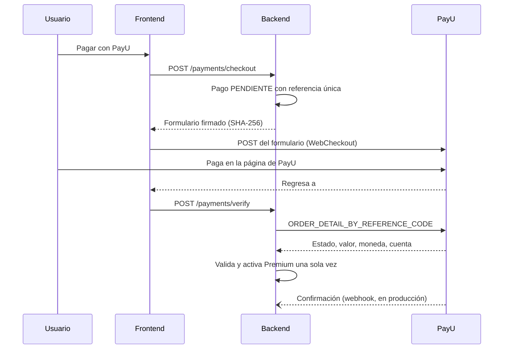

# Pagos del plan Premium (PayU Latam)

Premium cuesta **COP 49.900 por 30 días**: pago por periodo, sin cobros automáticos ni medios de pago guardados. AquaSense nunca ve ni guarda datos de tarjeta; el pago ocurre en la página segura de PayU.

## Modo de pruebas (configuración por defecto)

El sistema usa el **sandbox de PayU** con las credenciales públicas de prueba que PayU publica en su documentación ([Probar tu solución](https://developers-payu-latam.github.io/latam/es/docs/getting-started/test-your-solution.html)): comercio `508029`, cuenta `512321` (Colombia). No se mueve dinero real y no hace falta registrar un comercio ni tener RUT. Es un comercio de prueba compartido: otros desarrolladores también lo usan.

| Resultado | Tarjeta (VISA Colombia) | Nombre del titular | CVV | Vencimiento |
|---|---|---|---|---|
| Aprobado | 4097440000000004 | APPROVED | 777 | mes menor que 6, por ejemplo 05/2030 |
| Rechazado | 4097440000000004 | REJECTED | 666 | mes mayor que 6, por ejemplo 07/2030 |

## Cómo funciona

1. **Firma del formulario:** SHA-256 de `ApiKey~merchantId~referenceCode~amount~currency`. Una prueba automática comprueba que coincide con el ejemplo oficial de PayU.
2. **Verificación:** el servidor nunca confía en los parámetros con que PayU devuelve al usuario. Consulta la orden con la API de consultas y comprueba tres cosas: que el estado sea `APPROVED`, que la cuenta sea la del comercio y que el valor y la moneda sean los del pedido. Si algo no coincide, el pago queda en `ERROR` y no se activa Premium.
3. **Idempotencia:** un pago aprobado activa Premium una sola vez, aunque se verifique varias veces o llegue también la confirmación.
4. **Renovación:** si se paga antes de que venza, los 30 días se suman desde la fecha de vencimiento actual.
5. **Confirmación (webhook):** `POST /api/v1/payments/payu/confirmation`.
   - Se valida la firma `ApiKey~merchant_id~reference_sale~new_value~currency~state_pol`, con `new_value` en un decimal si el segundo es cero.
   - Después se consulta la orden igual que en el paso 2.
   - PayU solo la envía a una URL pública, así que en desarrollo con `localhost` no llega y basta la verificación del paso 2.
6. **Tareas automáticas cada hora:**
   - Premium vencido vuelve a Gratuito.
   - Los pagos abandonados por más de 24 h pasan a `EXPIRED`.
   - Tres días antes del vencimiento se envía un recordatorio por correo.
7. **Premium asignado por un administrador:** no tiene vencimiento y no se puede comprar encima.

Nota sobre la documentación de PayU: en el ejemplo "con un decimal" de la página de confirmación, el hash impreso (`b607a2c2…`) no corresponde a la cadena que muestran. El ejemplo "con dos decimales" sí coincide, y es el que usa la prueba automática.

## Verificado en vivo (7 nov 2026)

Pago completo en el sandbox real con el navegador: AquaSense, la página de PayU, la tarjeta de prueba y el regreso a AquaSense.

- **Rechazado:** PayU rechazó la transacción y AquaSense la registró como `DECLINED`, sin cambiar el plan.
- **Aprobado:** PayU aprobó la orden 2158432496 y AquaSense activó Premium hasta el 7 de diciembre de 2026.

## Configuración

| Variable | Por defecto | Uso |
|---|---|---|
| `PAYMENTS_ENABLED` | `true` | Activa los pagos |
| `PREMIUM_PRICE` · `PREMIUM_PERIOD_DAYS` | `49900` · `30` | Precio en COP y días por pago |
| `PAYMENTS_RESPONSE_URL` | `http://localhost:5500/#/billing` | Página a la que PayU devuelve al usuario |
| `PAYMENTS_CONFIRMATION_URL` | vacío | URL pública del webhook de confirmación (solo producción) |
| `PAYU_TEST` | `true` | Modo de pruebas |
| `PAYU_MERCHANT_ID`, `PAYU_ACCOUNT_ID`, `PAYU_API_KEY`, `PAYU_API_LOGIN`, `PAYU_CHECKOUT_URL`, `PAYU_API_URL` | credenciales públicas del sandbox | Solo para cobrar dinero real |

Para cobrar dinero real hace falta un comercio registrado en PayU, con sus documentos. Luego se definen las credenciales propias, `PAYU_TEST=false`, las URL de producción (`https://checkout.payulatam.com/ppp-web-gateway-payu/` y `https://api.payulatam.com`) y una URL pública HTTPS para la confirmación.
