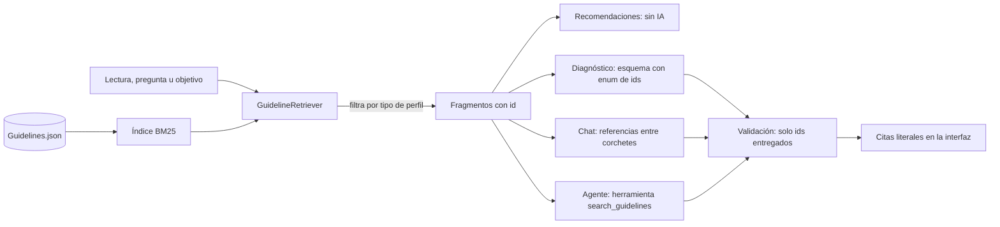

# Capa 6 · Respaldo normativo (RAG)

AquaSense recupera fragmentos **literales** de normas y guías oficiales y los cita junto a cada recomendación, diagnóstico, informe del agente y respuesta del asistente. La IA no puede citar una norma que el sistema no le entregó: cada id citado se comprueba en el servidor y los que no existen se descartan.

## Fuentes

| Id | Organización | Documento | Uso del agua | Carácter |
|---|---|---|---|---|
| `epa-sdws` | EPA (Estados Unidos) | Secondary Drinking Water Standards: Guidance for Nuisance Chemicals (actualizada el 26 may 2026) | General, potable | Guía no obligatoria; se basa en sabor, corrosión y depósitos, no en riesgo para la salud |
| `who-gdwq-ph` | OMS | Chemical fact sheets: pH, extraída de las Guías para la calidad del agua de consumo humano, 4.ª ed. con adendas 1 y 2 (2022) | General, potable | No fija un valor guía de salud para el pH |
| `cdc-mahc-2024` | CDC (Estados Unidos) | 2024 Model Aquatic Health Code, 5.ª edición (16 dic 2024) | Piscina | Código modelo; obligatorio solo donde una autoridad lo adopta |
| `fao-ipd29` | FAO | Water quality for agriculture, Ayers y Westcot, Irrigation and Drainage Paper 29 Rev. 1 (1985) | Riego | Guía técnica de interpretación |

**Acuarios: sin fuente.** No se encontró una norma oficial sobre el pH de acuarios que se pudiera descargar desde la red del entorno. La base no contiene fragmentos para acuarios y lo dice: recomendaciones, diagnósticos y chat muestran una nota de cobertura en lugar de una cita.

Los documentos se descargaron el 7 nov 2026. Hay 20 fragmentos en `src/main/resources/knowledge/Guidelines.json`. Cada uno tiene:

- `quote`: el texto literal, en inglés como el original. `[...]` marca una omisión.
- `summaryEs`: un resumen propio en español, que la interfaz rotula como "no es traducción oficial".
- `section` y `url`, para ubicar el texto en el documento.
- `profileTypes`: los usos del agua a los que aplica.
- `tags`: rango, pH bajo, pH alto, crítico, acción, frecuencia de medición, salud o laboratorio.
- `phMin` y `phMax`, cuando el fragmento define un rango.

`scripts/VerifyKnowledgeQuotes.py` comprueba que cada cita aparezca literal en el texto descargado (resultado: 20/20). Los documentos no se guardan en el repositorio. Para repetir la prueba hay que descargarlos de las URL de la tabla y convertir los PDF a texto con `pdftotext -layout`.

## Cómo funciona

1. **Indexación.** `KnowledgeBase` carga y valida el archivo al iniciar. Si hay un id repetido, una fuente inexistente o una cita vacía, la aplicación no arranca. `TextAnalyzer` pasa el texto a minúsculas, quita tildes y palabras vacías (en español e inglés), conserva los decimales y recorta cada palabra a 6 letras. Así "corrosión", "corrosivo" y "corrosive" quedan como el mismo término.
2. **Recuperación.** `Bm25Index` (Okapi BM25, k1 = 1,2, b = 0,75) puntúa la cita, el resumen, la sección y las palabras clave. `GuidelineRetriever` combina tres señales:
   - BM25, normalizado: 60 % del puntaje.
   - Las etiquetas que pide el estado del agua: 30 %. Por ejemplo, un pH crítico bajo pide rango, pH bajo, acción, crítico y salud.
   - Una bonificación de 0,1 si el fragmento define un rango numérico.

   Solo devuelve fragmentos del tipo de perfil activo, así una norma de piscinas nunca respalda un consejo de riego. Un perfil personalizado usa los fragmentos generales de la EPA y la OMS.
3. **Generación con citas.**
   - **Recomendaciones:** no usan IA; muestran los 3 fragmentos mejor clasificados.
   - **Diagnóstico:** los fragmentos entran en los hechos como `guidelineFragments`. El esquema JSON de cada solicitud limita `citedSourceIds` a un `enum` con esos ids. `DiagnosisValidator` vuelve a comprobarlos y registra cada cita descartada en las salvaguardas. El diagnóstico por reglas cita los 3 primeros.
   - **Chat:** recibe hasta 4 fragmentos y debe citarlos como `[id]`. `CitationReferences` conserva solo los ids entregados y borra del texto cualquier otro.
   - **Agente:** usa la herramienta `search_guidelines`; el tipo de perfil lo fija el servidor. En `submit_report` solo se conservan los ids que esa herramienta devolvió en la misma ejecución; el resto se informa en `discardedCitations`.

Se eligió BM25 en lugar de embeddings porque la base es pequeña y curada. BM25 es determinista, no necesita servicios externos ni cuota, y cada resultado se explica por los términos que coinciden.

## Cambio en los perfiles del sistema (migración V6)

| Perfil | Antes | Ahora | Fuente |
|---|---|---|---|
| Piscina | ideal 7.2–7.8, precaución 7.0–8.0 | ideal 7.0–7.8, precaución 6.5–8.0 | MAHC 2024: 5.7.3.4.1 (7.0–7.8) y 6.6.3.1 (riesgo inminente con pH menor de 6.5 o mayor de 8.0) |
| Riego | ideal 6.0–7.5, precaución 5.5–8.4 | ideal 6.5–8.4, precaución 6.0–8.5 | FAO: sección 5.2 y tabla 1 (rango normal 6.5–8.4), tabla 2 (rango usual 6.0–8.5) |
| General, potable, acuario | Sin cambio de rangos | Texto de fuente corregido | La OMS no fija un valor guía de salud; acuario sin norma verificada |

Las mediciones ya guardadas conservan el estado con el que se clasificaron.

## API

| Método | Ruta | Descripción |
|---|---|---|
| GET | `/api/v1/knowledge/sources` | Fuentes, fragmentos de cada una y cobertura por tipo de perfil |
| GET | `/api/v1/knowledge/search?q=&profileType=&limit=` | Búsqueda BM25 (máximo 200 caracteres y 10 resultados) |
| GET | `/api/v1/knowledge/chunks/{id}` | Un fragmento (404 si no existe) |

Campos nuevos en otras respuestas:

- `recommendations`: `sources` y `coverageNote`.
- `diagnosis`: `citations` y `coverageNote`.
- `chat`: `citations` y `removedReferences`.
- Informe del agente: `citations` y `discardedCitations`.

## Verificación (7 nov 2026)

- **Pruebas:** 97/97 en total, 12 nuevas. Cubren la base y su cobertura, el analizador, BM25, la recuperación por perfil, el filtro de referencias del chat, el validador de diagnósticos, el agente contra un servidor falso con una cita inventada (descartada) y los endpoints.
- **Prueba en vivo:** un usuario con perfil Piscina y pH 6.3.
  - Las recomendaciones citaron la CDC 6.6.3.1, 5.7.3.4.2 y 5.7.3.4.1.
  - El chat (Gemini 3.5 Flash-Lite) respondió en 3,4 s con 3 citas válidas y 0 eliminadas.
  - El diagnóstico (Gemini 3.5 Flash-Lite) dio riesgo crítico citando `mahc-imminent-hazard` y `mahc-ph-range`.
  - El agente buscó en la biblioteca por su cuenta, citó 4 fragmentos de la CDC y verificó 31/31 cifras.
  - Groq gpt-oss-120b aceptó el esquema estricto con el `enum` de ids.

## Límites

- La base es pequeña (20 fragmentos) y está en inglés. La búsqueda funciona en español gracias a los resúmenes y las palabras clave en español.
- Las normas de la EPA y de la CDC son de Estados Unidos y sus valores no obligan en otros países. La interfaz muestra el carácter legal de cada fuente; hay que verificar la norma local.
- Las citas respaldan el criterio, no el estado real del agua: el pH por sí solo no demuestra potabilidad.
- Agregar una fuente requiere descargar el documento, copiar el texto exacto, ejecutar el script de verificación y añadir pruebas.
