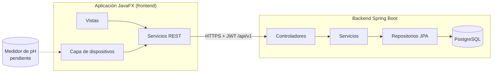
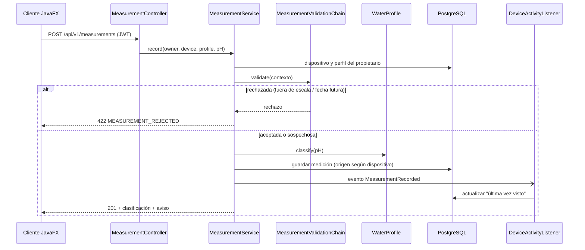
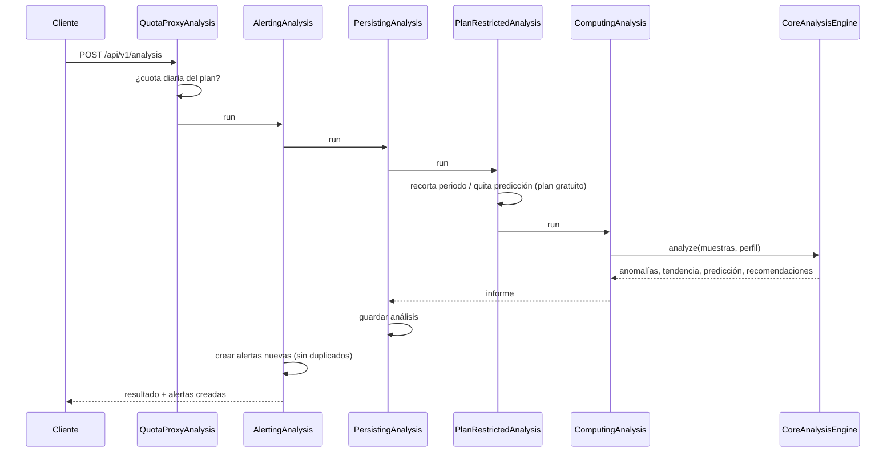
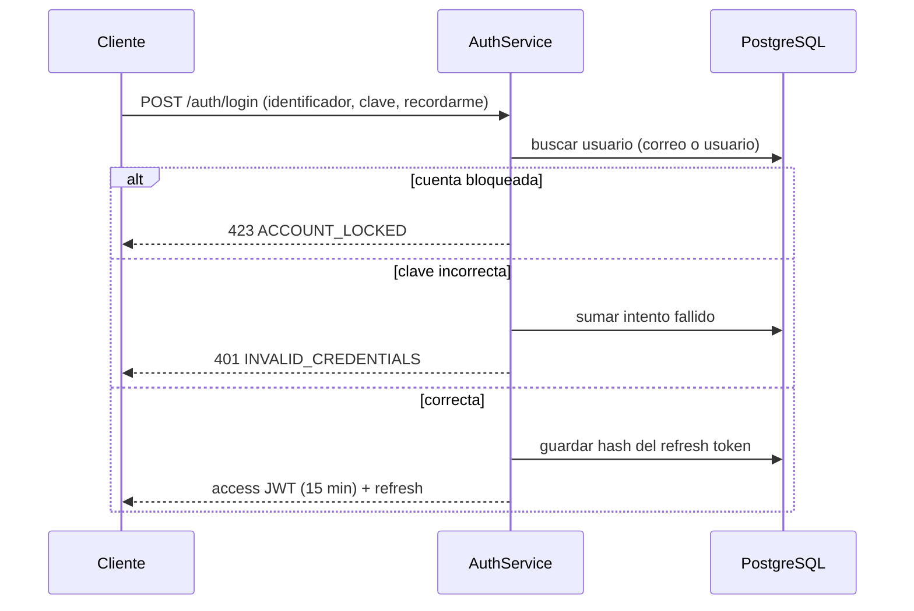
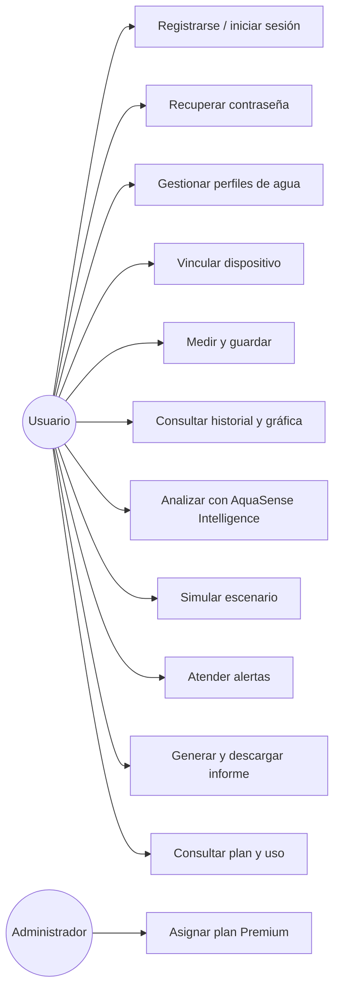

# Arquitectura del backend

## Visión general

AquaSense AI se compone de tres partes: un **medidor de pH** (hardware, aún sin integrar), una **aplicación de escritorio JavaFX** (repositorio frontend) y este **servidor REST**. El servidor es un **monolito modular**: un solo despliegue, con módulos de responsabilidad clara. No se usan microservicios porque el alcance y el plazo (una semana) no lo justifican.

El cliente **nunca** se conecta a PostgreSQL ni conoce credenciales de infraestructura. Toda regla de negocio y todo límite de plan viven en el servidor.

## Módulos

| Módulo | Responsabilidad | Depende de |
|---|---|---|
| `identity` | Registro, login, JWT, refresh, recuperación, bloqueo, roles | — |
| `waterprofile` | Perfiles del sistema y personalizados, clasificación por rangos | `billing` (límite de perfiles) |
| `device` | Dispositivos del usuario y su origen real/simulado | `billing` (límite de dispositivos) |
| `measurement` | Registro, validación (cadena), historial con filtros, evento de medición | `device`, `waterprofile` |
| `intelligence` | Motor estadístico, alertas, historial de análisis, escenarios | `measurement`, `waterprofile`, `billing` |
| `reporting` | Informes (Builder/Composite/Visitor), persistencia y descarga | `intelligence`, `measurement`, `billing` |
| `billing` | Planes, límites, suscripciones, uso | `device`, `waterprofile`, `intelligence` (solo repositorios para contar) |
| `shared` | `DomainException`, `ApiError`, manejador global, `Specification` | — |

Cada módulo sigue la estructura `api` (controladores y DTO) → `service` → `repository` → `domain`. Las entidades JPA **no** se exponen: la API usa DTO (records).

## Decisiones y contradicciones resueltas

| Tema | Requisito original | Decisión | Justificación |
|---|---|---|---|
| Base de datos | El documento propone SQLite; el prompt maestro pide PostgreSQL | **PostgreSQL** | Cuentas múltiples, integridad, transacciones y despliegue en la nube. SQLite solo tendría sentido para caché local, que no se necesitó. |
| Dónde vive el dispositivo | Backend "comunica con dispositivos" | **Capa de dispositivos en el cliente** | Un medidor Bluetooth/USB está junto al usuario, no junto al servidor en la nube. El servidor valida y clasifica cada lectura recibida. |
| Tema por defecto | El documento muestra un diseño oscuro | **Tema claro por defecto**, oscuro disponible | Lo exige el prompt maestro. |
| HTML | Se permite un HTML solo para enlazar con Java | Frontend 100 % Java; el único HTML es el **informe exportado** por el servidor | Es un documento de salida, no lógica de aplicación. |
| Pagos | "Implementar pagos reales" y "no simular pagos" | Límites reales; **cobro en línea pendiente** | No hay credenciales de pasarela; simularlo violaría la regla de no fingir integraciones. |
| IA | "Usar una API real" | Análisis estadístico propio; **API generativa pendiente** | Requiere clave del proveedor, que el usuario aplazó. |
| Singleton | Lista de patrones propone Singleton | Se usa el ámbito singleton de Spring; no se escribió un Singleton propio | Un Singleton manual dificulta las pruebas y duplica lo que ya ofrece la inyección de dependencias. |

## Seguridad

- Argon2id para contraseñas (`Argon2PasswordEncoder`).
- JWT HS256 de 15 minutos; refresh opaco rotatorio almacenado como SHA-256.
- Sin sesión de servidor (`STATELESS`); CSRF desactivado porque no se usan cookies.
- Acceso por propietario en todas las consultas (`owner_id`).
- Errores controlados sin trazas hacia el cliente (`GlobalExceptionHandler`).
- Informes HTML: texto escapado, sin scripts, cabeceras `Content-Security-Policy` y `X-Content-Type-Options: nosniff`.
- HTTPS: se termina en la plataforma de despliegue (`server.forward-headers-strategy=framework`).
- **No implementado:** limitación de tasa por IP en endpoints públicos (solo bloqueo de cuenta y cuotas por plan).

## Diagramas de secuencia

### Registrar una medición

### Ejecutar un análisis

### Inicio de sesión

## Diagrama de casos de uso

