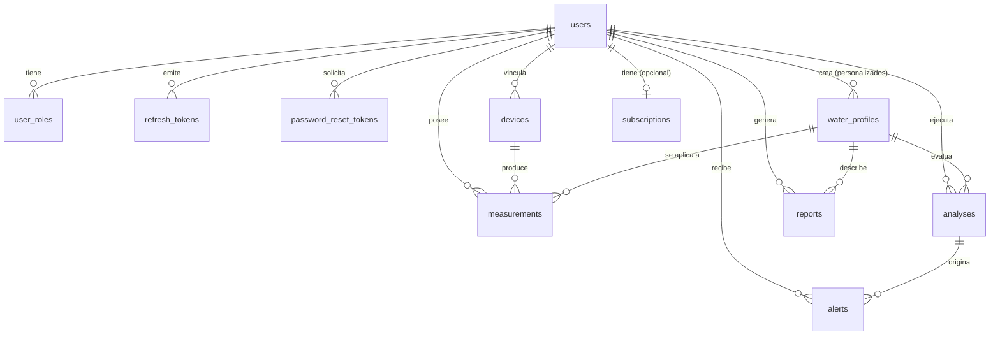

# Modelo de datos

PostgreSQL, gestionado con migraciones Flyway (`src/main/resources/db/migration`, V1 a V6). Hibernate solo **valida** el esquema (`ddl-auto: validate`).

## Diccionario de datos

**users**: `id` UUID PK · `email` (único sin distinguir mayúsculas) · `username` (opcional, único) · `display_name` · `password_hash` (Argon2id) · `enabled` · `failed_login_attempts` · `locked_until` · `created_at` · `updated_at`.

**user_roles**: `user_id` FK · `role` ∈ {USER, ADMIN} · PK compuesta.

**refresh_tokens**: `id` · `user_id` FK · `token_hash` (SHA-256, único) · `expires_at` · `revoked_at` · `created_at`.

**password_reset_tokens**: `id` · `user_id` FK · `token_hash` (único) · `expires_at` · `used_at` · `created_at`.

**water_profiles**: `id` · `owner_id` (nulo = perfil del sistema) · `type` ∈ {DRINKING, POOL, AQUARIUM, AGRICULTURE, GENERAL, CUSTOM} · `name` · `description` · `optimal_min/max` · `caution_min/max` (NUMERIC(4,2)) · `source_reference` · restricciones: `caution_min ≤ optimal_min < optimal_max ≤ caution_max`, rango 0–14, y un perfil CUSTOM siempre tiene dueño.

**devices**: `id` · `owner_id` FK · `name` · `manufacturer` · `model` · `external_id` · `connection_type` ∈ {BLUETOOTH, USB_SERIAL, SIMULATOR} · `source_kind` ∈ {REAL, SIMULATED} · `last_seen_at` · único `(owner_id, external_id)` · restricción: `SIMULATOR` ⇔ `SIMULATED`.

**measurements**: `id` · `owner_id` FK · `device_id` FK · `profile_id` FK · `ph` NUMERIC(4,2) con `0 ≤ ph ≤ 14` · `measured_at` · `received_at` · `source_kind` · `acidity` ∈ {ACIDIC, NEUTRAL, ALKALINE} · `range_status` ∈ {OPTIMAL, CAUTION, CRITICAL} · `validation_status` ∈ {VALID, SUSPECT} · `validation_notes`. Índice `(owner_id, measured_at DESC)`.

**analyses**: `id` · `owner_id` · `profile_id` · `period_from/to` · `measurement_count` · `sufficient_data` · `report_json` (informe serializado) · `created_at`.

**alerts**: `id` · `owner_id` · `analysis_id` · `type` · `severity` ∈ {INFO, WARNING, CRITICAL} · `measured_at` · `ph` · `message` · `explanation` · `created_at` · `acknowledged_at` · único `(owner_id, type, measured_at)` para evitar duplicados.

**subscriptions**: `id` · `owner_id` (único) · `plan` ∈ {FREE, PREMIUM} · `status` ∈ {ACTIVE, CANCELED, EXPIRED} · `started_at` · `current_period_end` · `source` (hoy solo `ADMIN`) · `granted_by`.

**reports**: `id` · `owner_id` · `profile_id` · `title` · `format` ∈ {MARKDOWN, HTML} · `period_from/to` · `measurement_count` · `content` · `created_at`.

## Tablas del requisito que NO existen

El prompt maestro menciona pagos, preferencias y un historial de operaciones. **No se crearon** `payments` ni `user_preferences` ni una tabla de auditoría porque ninguna funcionalidad las usa todavía; crearlas vacías habría simulado trabajo inexistente. La preferencia de tema se guarda en el cliente.

## Integridad y borrado

Al borrar un usuario se eliminan en cascada sus dispositivos, perfiles, mediciones, análisis, alertas, informes y suscripción. Un dispositivo con mediciones no puede desvincularse (`ON DELETE RESTRICT`, respuesta `409 DEVICE_HAS_MEASUREMENTS`).
