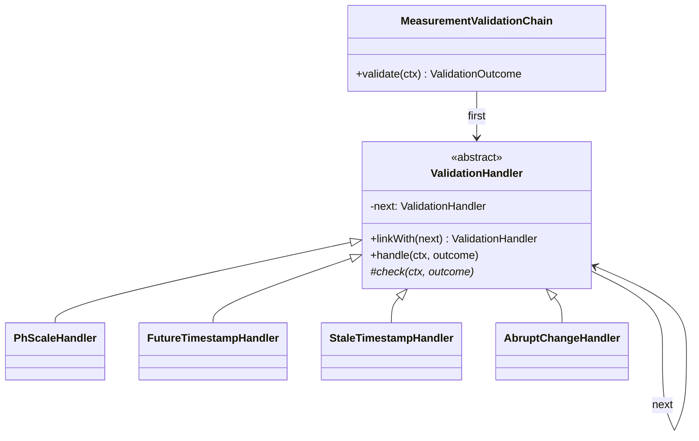
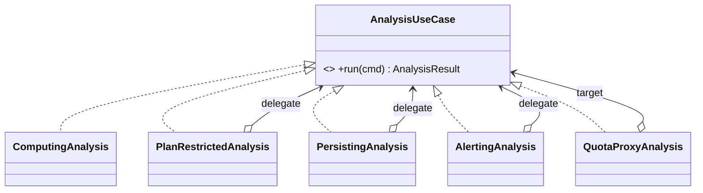
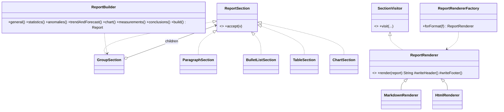
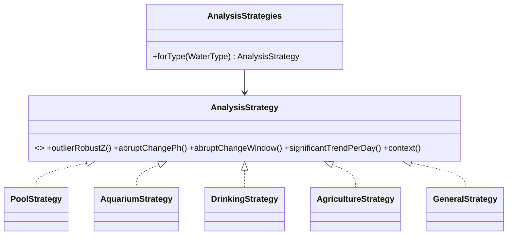

# Catálogo de patrones de diseño

Regla aplicada: **un patrón solo figura como implementado si cumple una función real en el producto y tiene una prueba que lo ejercita.** Las clases del cliente JavaFX están en el repositorio [FrontendPatSft](https://github.com/WillC372/FrontendPatSft).

## Matriz de patrones implementados

| # | Patrón | Categoría | Módulo | Problema real que resuelve | Clases principales | Prueba |
|---|---|---|---|---|---|---|
| 1 | Chain of Responsibility | Comportamiento | measurement | Validar una lectura con reglas independientes y ordenadas; algunas rechazan y otras solo marcan como sospechosa | `ValidationHandler`, `PhScaleHandler`, `FutureTimestampHandler`, `StaleTimestampHandler`, `AbruptChangeHandler`, `MeasurementValidationChain` | `MeasurementValidationChainTest`, `MeasurementApiIntegrationTest` |
| 2 | Chain of Responsibility | Comportamiento | intelligence | Detectar anomalías con detectores intercambiables que acumulan hallazgos | `AnomalyDetector`, `RangeBreachDetector`, `StatisticalOutlierDetector`, `AbruptChangeDetector`, `AnomalyDetectionChain` | `AnalysisEngineTest` |
| 3 | Strategy | Comportamiento | intelligence | La sensibilidad cambia por tipo de agua (un acuario tolera menos variación que un riego) | `AnalysisStrategy`, `PoolStrategy`, `AquariumStrategy`, `DrinkingStrategy`, `AgricultureStrategy`, `GeneralStrategy`, `AnalysisStrategies` | `AnalysisEngineTest.strategyChangesSensitivityByWaterType` |
| 4 | Specification | Empresarial | waterprofile / shared | Expresar reglas de rango combinables (y, o, no) para clasificar | `Specification`, `PhRangeSpecification`, `WaterProfile.classify` | `WaterProfileDomainTest.specificationsCompose` |
| 5 | Prototype | Creacional | waterprofile | Duplicar un perfil del sistema para personalizarlo sin alterar el original | `WaterProfile.copyFor` | `WaterProfileDomainTest.copyCreatesIndependentCustomProfile…`, `WaterProfileApiIntegrationTest` |
| 6 | Observer (evento de dominio) | Comportamiento | measurement → device | Actualizar "última vez visto" del dispositivo sin acoplar `measurement` a la lógica de `device` | `MeasurementRecorded`, `DeviceActivityListener`, `ApplicationEventPublisher` | `MeasurementApiIntegrationTest.measurementUpdatesDeviceLastSeenThroughEvent` |
| 7 | Decorator | Estructural | intelligence | Añadir restricciones de plan, persistencia y alertas al análisis sin tocar el cálculo | `AnalysisUseCase`, `ComputingAnalysis`, `PlanRestrictedAnalysis`, `PersistingAnalysis`, `AlertingAnalysis` | `IntelligenceApiIntegrationTest`, `FreemiumIntegrationTest` |
| 8 | Proxy (de protección) | Estructural | intelligence / billing | Controlar el acceso al análisis según la cuota diaria del plan | `QuotaProxyAnalysis`, `LimitGuard` | `FreemiumIntegrationTest.freeAnalysisHasNoForecastAndIsLimitedPerDay` |
| 9 | Builder | Creacional | reporting | Armar un informe con secciones opcionales según plan y petición | `ReportBuilder` | `ReportApiIntegrationTest` |
| 10 | Composite | Estructural | reporting | Representar el informe como árbol de secciones | `ReportSection`, `GroupSection`, `ParagraphSection`, `BulletListSection`, `TableSection`, `ChartSection` | `ReportRenderingTest` |
| 11 | Visitor | Comportamiento | reporting | Generar Markdown y HTML a partir del mismo árbol sin modificar las secciones | `SectionVisitor`, `MarkdownRenderer`, `HtmlRenderer` | `ReportRenderingTest` |
| 12 | Template Method | Comportamiento | reporting | Fijar el esqueleto común (cabecera, cuerpo, pie) de todo renderizador | `ReportRenderer.render` | `ReportRenderingTest` |
| 13 | Factory Method | Creacional | reporting | Elegir el renderizador según el formato pedido | `ReportRendererFactory` | `ReportRenderingTest.factoryReturnsRendererPerFormat` |
| 14 | Repository | Empresarial | todos | Aislar el acceso a datos de la lógica de negocio | interfaces `*Repository` (Spring Data) | pruebas de integración de cada módulo |
| 15 | Service Layer | Empresarial | todos | Centralizar los casos de uso | clases `*Service` | pruebas de integración |
| 16 | DTO | Empresarial | todos | No exponer entidades de persistencia | records en paquetes `api` (`*Dtos`) | pruebas de API |
| 17 | Dependency Injection | Empresarial | todos | Desacoplar implementaciones y facilitar pruebas | inyección por constructor de Spring | `IntelligenceConfig` compone los decoradores |
| 18 | Token-Based Authentication | Seguridad | identity | Sesiones sin estado en el servidor | `JwtService`, `JwtAuthenticationFilter`, `AuthService` (refresh rotatorio) | `AuthApiIntegrationTest`, `JwtServiceTest` |

## Patrones del catálogo que NO se implementaron

| Patrón | Motivo |
|---|---|
| Singleton | Spring ya ofrece beans de ámbito singleton; un Singleton propio no aportaba nada y dificulta las pruebas. |
| Abstract Factory, Adapter, Bridge | Su uso real es la integración de **medidores físicos** (familias de conectores, adaptar protocolos). Aún no hay hardware ni protocolo confirmado; crearlos vacíos sería decorativo. Se implementarán con el primer medidor. |
| Mediator, Memento, Flyweight, Iterator propio, CQRS, API Gateway | No hay un problema real que justifique cada uno en el alcance actual. |
| Unit of Work y Data Mapper | Los aporta el marco (JPA/Hibernate y `@Transactional`); no se escribió una implementación propia. |
| Circuit Breaker, Retry, Bulkhead, Thread Pool, Producer-Consumer, Read-Write Lock | Se necesitan al integrar un servicio externo (IA, pasarela de pago), que aún no existe. |
| Rate Limiting | Hay cuotas por plan y bloqueo de cuenta, pero **no** limitación de tasa por IP; no se afirma. |

## Diagramas UML

### Cadena de validación de mediciones

Ejemplo: un pH de 15 lo rechaza `PhScaleHandler` y la cadena se detiene; un salto de 2,5 unidades en 3 minutos lo acepta pero lo marca `SUSPECT`.

### Análisis con decoradores y proxy

La composición real (en `IntelligenceConfig`) es `QuotaProxy → Alerting → Persisting → PlanRestricted → Computing`. El informe usa `PlanRestricted → Computing` (sin guardar análisis ni crear alertas).

### Informe: Builder, Composite y Visitor

### Estrategias de análisis

Ejemplo: con la misma serie, un salto de 0,4 en una hora es anomalía para `AquariumStrategy` (umbral 0,3) y no lo es para `AgricultureStrategy` (umbral 1,0).

## Beneficio arquitectónico

- **Decorator/Proxy:** el cálculo no sabe de planes, base de datos ni alertas; cada preocupación se añade o quita sin editarlo.
- **Visitor + Composite:** un formato nuevo (por ejemplo PDF) se añade con un renderizador, sin tocar el informe.
- **Cadenas:** una regla nueva de validación o de anomalía es una clase más, sin modificar las existentes.
